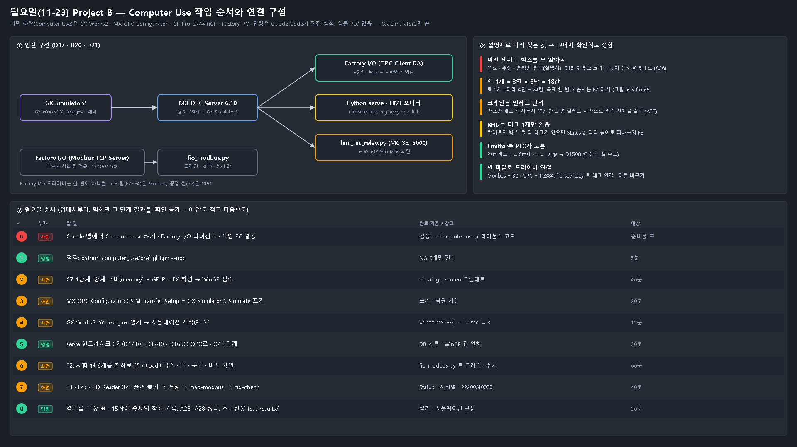

# 월요일(2026-11-23) Project B — Computer Use 작업 지시서

> 이 파일은 **월요일에 Computer Use(화면 조작) + Claude Code(명령 실행)로 Project B를 진행할 때** 그대로 따라 하는 순서입니다.
> 금요일(11-20)에 이 PC(`로봇제어실ST26`)에서 미리 준비한 도구 · 그림 · 시험 씬을 씁니다.
> 결정 · 결과 기록은 [`확인필요_및_논의사항.md`](../확인필요_및_논의사항.md) **15장**(준비 · 결과 표), 지난 지시서는 10장, 지난 결과는 11장입니다.



## 0. 시작 전에 사람이 할 일

| # | 할 일 | 왜 | 상태(11-20) |
|---|---|---|---|
| H1 | Claude 데스크톱 앱 **설정 → Computer use 켜기** (설정에 System 메뉴가 없으면 Capabilities) | 지금 세션에는 화면 조작 도구가 없음 | 꺼져 있음(도구 없음) |
| H2 | **Factory I/O 라이선스**: 이 PC는 플로팅 라이선스가 **만료**(`Player.log`: 11-06 · 11-20 "License is expired") → 담당자에게 갱신 · 공유 코드를 받거나, F2~F4만 B 작업 PC(11-19 유효)에서 | F2~F4 · 씬 작업 전부 막힘 | ❌ 만료 |
| H3 | 작업 PC 정하기: **이 PC 권장**(GX Works2 · MX OPC · GP-Pro EX/WinGP · Factory I/O 모두 설치, 화면 1920 × 1080 · 100%) | 도구 · 결과 경로가 이 PC 기준 | 권장: 이 PC |
| H4 | 요청 파일 전달 (아래 0-1) | 씬 · MX OPC 설정 복사용 | 요청 중 |
| H5 | Claude Code 권한: 월요일에 `python ...` 명령이 막히면 그때 승인. 쓰기 명령(OPC 쓰기 · Modbus 쓰기)이 들어감 | 11-19에 auto mode가 Modbus 쓰기를 거부 | – |
| H6 | 방화벽 창(중계 서버 · Factory I/O)이 뜨면 **개인 네트워크 허용**을 사람이 누름 | 보안 설정은 사람이 | – |

### 0-1. 요청 파일 (가능한 것만)

| # | 파일 | 어디서 | 쓰는 곳 | 없으면 |
|---|---|---|---|---|
| R1 | `문서\Factory IO\My Scenes\ProjectB*.factoryio` (5개) | B 작업 PC | RFID 실측 위치(X=270, Y=10, Z=139) · RFID 리더 태그 이름 · 기존 OPC 연결 확인 | RFID 리더를 새로 끌어 놓고 시험(가능) |
| R2 | MX OPC 프로젝트 `.mdb` (장치 `QSIM` = GX Simulator 연결) — 경로는 그 PC 레지스트리 `HKLM\SOFTWARE\WOW6432Node\Mitsubishi\MXOPCServer\Configuration\FileName` | B 작업 PC | `mxopc_db.py copy-conn`으로 이 PC `CSIM`에 연결값 복사 → Configurator 조작 생략 | Configurator 화면에서 직접 설정(3단계) |
| R3 | 원래 MX OPC 프로젝트 `G:\수업\MXOPC\Project.mdb` (USB) | 사용자 USB | 이 PC 원래 설정 복원(레지스트리 원래 값) | 지금 `test_results/MXOPC_C_env.mdb` 계속 사용 |
| R4 | `E:\PLC\1\세탁기.gxw` 등 원본 PLC 프로젝트 | 원래 PC | 기종 확인(4-1, 보기만) | Q03UDE로 계속(W1) |
| R5 | Factory I/O 라이선스 코드 · 담당자 연락 | 학교/담당자 | H2 | F2~F4는 B 작업 PC에서 |
| R6 | WinGP 라이선스 키 (있으면) | 담당자 | C7 체험판 시간 제한 회피 | 체험판으로 진행, 종료 시각 기록 |

## 1. Computer Use 접근 요청할 앱

`request_access` 한 번에: **Factory IO**, **GX Works2**(`GD2.exe`), **MX OPC Configurator**(`MXConfigurator.exe`), **GP-Pro EX**(`Designer.Frame.exe`), **WinGP**(`PCRuntime.exe`), **파일 탐색기**.

- 터미널 · IDE는 "click" 단계(입력 불가) → 명령은 **Claude Code의 Bash/PowerShell**로 실행.
- 브라우저는 "read" 단계 → `v7.html` · `3d_*.html` 확인은 앱의 내장 브라우저 도구로.
- 화면 좌표는 1920 × 1080 · 배율 100% 기준.

## 2. 공통 규칙 (10장 + 11-19 · 11-20 경험)

- 실물 PLC 없음. GX Works2는 **시뮬레이션**만, "PLC 쓰기/읽기/RUN"(실기) 금지. 원본 프로젝트 · 원본 씬 저장 금지.
- 새 파일은 `test_results\`(래더 · HMI · 스크린샷) · `factoryio_test\`(씬)에 새 이름으로.
- OPC · Modbus **쓰기 시험은 원래 값을 읽어 두고 끝나면 복원**(`c_env_opc_raw.py --write`는 자동 복원).
- 확인 못 한 것은 "확인 불가 + 이유", 시뮬레이션 결과와 실기 결과를 섞지 않음. 결과는 **15장 표**에 숫자와 함께.
- 스크린샷은 `test_results\<단계>_<내용>.png`.

### 알려진 함정

| 앱 | 증상 (11-19) | 대처 |
|---|---|---|
| Factory I/O | **글자 입력이 안 됨**(팔레트 검색 · 숫자 칸 · 태그 이름). CONFIGURATION 버튼이 클릭에 반응 안 함 | 글자가 필요한 일은 **씬을 저장 → `fio_scene.py`로 파일 수정 → 다시 열기**. 드라이버 선택 · 태그 연결도 씬 파일로(Modbus = 32, OPC = 16384). 버튼은 마우스를 먼저 올린 뒤 클릭. 드라이버 창은 **F4** |
| Factory I/O | 씬 목록에서 찾기 번거로움 | `"C:\Program Files (x86)\Real Games\Factory IO\Factory IO.exe" "load:<씬 경로>"`로 바로 열기 |
| Factory I/O | Run 중 Int 태그 강제값은 입력이 필요 | 비트는 태그 라벨 클릭(센서 `I` · 액추에이터 `O` 키로 표시), 숫자는 `fio_modbus.py` |
| GX Works2 | 파라미터 첫 열기에 `ES:03ff0004` | 한 번 더 열기 |
| GX Works2 | Q03UDV 없음 | Q03UDE로 (W1) |
| GX Works2 · GP-Pro EX | 한글 입력기 상태면 명령어가 한글로 들어감 | 입력 전 **한/영 → 영문** 확인 |
| MX OPC | Configurator에서 바꾼 뒤 그대로면 반영 안 됨 | 저장 → OPC 클라이언트(중계 · serve · Factory I/O) 모두 끄기 → 다시 켜기 |
| Claude Code | auto mode가 쓰기 명령을 거부할 수 있음 | 사용자 승인 요청, 거부되면 "미실행(권한)"으로 기록 |

## 3. 작업 순서

시간은 예상치입니다. 막히면 그 단계 결과를 적고 다음으로 넘어갑니다.

### 1단계 — 점검 (명령, 5분)
```
python computer_use/preflight.py --opc --md test_results/preflight_1123.md
```
- 완료 기준: NG 0개(라이선스 NG면 H2 처리 전까지 6 · 7단계 보류). 결과 파일을 15장에 링크.

### 2단계 — C7 1단계: WinGP ↔ 중계 서버(메모리) (화면, 40분)
그림: [img/c7_wingp_screen.png](img/c7_wingp_screen.png)
1. 명령: `python hmi_mc_relay.py --backend memory --demo --verbose` (백그라운드, 콘솔 출력 보관)
2. 화면: GP-Pro EX 새 프로젝트 → 그림 오른쪽 표대로 설정 → 화면 1에 숫자 표시 5 · 램프 1 · 스위치 1 → `test_results\C7_hmi.prx` 저장
3. WinGP로 전송 · 실행(키 없으면 체험판, **시작 시각 기록**)
4. 확인: D1900이 1초마다 증가 · X1900 깜박임 · 리셋 스위치 → 콘솔 `쓰기 M1920 … = [1]` · 카운터 0. 콘솔의 `[오류 …]` · `C059` 명령 번호 기록
5. 스크린샷 `C7_장치설정.png` · `C7_WinGP.png` · `C7_중계콘솔.png`
- WinGP는 그대로 두고 체험판 종료 시각 · 메시지 기록(5단계와 겹쳐 진행)

### 3단계 — MX OPC 장치 `CSIM` → GX Simulator2 (화면 또는 명령, 20분)
- **R2 파일이 있으면(명령):** MX OPC 관련 프로그램을 모두 끈 뒤
  ```
  python computer_use/mxopc_db.py copy-conn --src <B PC mdb> --src-device QSIM --device CSIM
  python computer_use/mxopc_db.py simulate off --device CSIM
  python computer_use/mxopc_db.py show
  ```
- **없으면(화면):** `MXConfigurator.exe` → 프로젝트 `test_results\MXOPC_C_env.mdb` → 장치 `CSIM` 속성 → 통신 설정(Transfer Setup): **PC 쪽 I/F = GX Simulator2**(목록 이름 그대로 기록), CPU = **Q03UDE**, **Simulate 끄기** → 저장. 태그 Simulate는 `mxopc_db.py simulate off`로 한 번에(Configurator를 닫고).
- 바꾼 값과 화면 이름을 15장에 기록(다음에 DB로 바로 넣을 수 있게).

### 4단계 — GX Works2 시뮬레이션 (화면, 15분)
1. `test_results\W_test.gxw` 열기(테스트 프로젝트라 저장 가능) → **[디버그] → [시뮬레이션 시작]** → RUN
2. **GX Simulator2는 하나만** 띄움(11장 C5: 둘이면 OPC가 다른 쪽에 붙음)
3. 확인(명령): `python tools/mxopc_tags.py --check --device CSIM` → 100/100, 품질 Good

### 5단계 — OPC 쓰기 · serve 핸드셰이크 · C7 2단계 (명령 + 화면, 30분)
```
py -3.12 test_results/c_env_opc_raw.py CSIM --write D1700 1234
python measurement_engine.py handoff --count 20 --db test_results/monday.db
python measurement_engine.py serve --opc-device CSIM --db test_results/monday.db          (백그라운드)
python computer_use/plc_side_check.py --opc-device CSIM --db test_results/monday.db
python hmi_counter_monitor.py --opc-device CSIM
python hmi_mc_relay.py --backend opc --opc-device CSIM --verbose                         (백그라운드)
```
- 쓰기 → 다시 읽기 → 복원. `plc_side_check.py`가 PLC 쪽 요청을 OPC로 보내 핸드셰이크 3개(메인 `D1710` · 재검사 `D1740` · 발열 격리 `D1650`)를 확인하고, 건드린 번지를 원래 값으로 되돌림(12장 P2의 시뮬레이션판). GX Works2 [현재값 변경]은 화면 확인용으로만.
- C7 2단계: WinGP 그대로 → GX Works2에서 `X1900` ON/OFF 3회 → WinGP `D1900` = 3, `mxopc_tags.py`로도 3. WinGP `M1920` → 0.
- 완료 기준: 핸드셰이크 3개 응답 시간 · DB 행 수 · WinGP 값 일치를 숫자로.

### 6단계 — F2: 박스 · 랙 · 분기 · 비전 (화면 + 명령, 60분, **라이선스 필요**)
시험 씬은 금요일에 만들어 둠(`python computer_use/fio_scene.py tests`, Factory I/O 기본 씬 복사본 + Small/Large box + Modbus Server 선택).
| 씬 | 볼 것 | 도구 |
|---|---|---|
| `factoryio_test\F2a_asrs_pallet_SL.factoryio` | 팔레트 + Small/Large box를 크레인이 랙에 넣고 빼는지, **목표 칸 번호 순서**(그림 [asrs_fio_v6](img/asrs_fio_v6.png) ③) | `python computer_use/fio_modbus.py crane --scene <씬> --target 1` 등 |
| `F2b_asrs_box_only_SL` | **팔레트 없이** 박스만 들 수 있는지 (A28) | 같음 |
| `F2c_popup_SL` | Pop-up Wheel Sorter 좌 · 우 · 직진(Small/Large) | 액추에이터 라벨 클릭 또는 `fio_modbus.py set --scene <씬> "Send left=on"` |
| `F2d_popup_pallet_L` | 팔레트가 Pop-up Wheel을 지나가는지 (A28) | 같음 |
| `F2e_vision_pusher_SL` | **비전 값**(Small/Large → 0이면 A26 확정), Pusher로 Large box가 밀리는지 | `fio_modbus.py get --scene <씬> "Vision sensor 1"` |
| `F2f_stopblade_SL` | Stop Blade가 Small/Large를 세우는지 | 라벨 클릭 |
- 공통: 씬 열기(`load:`) → F4 드라이버 창에서 **Modbus TCP/IP Server · CONNECT**(자동 연결 꺼짐) → Play(F5) → 명령.
- 참고: Conveyor Scale(F2c · F2d)은 무게(Float)를 줌 → Small 8 kg · Large 15 kg 구분 가능(A26의 다른 안).

### 7단계 — F3 · F4: RFID 3개 (화면 + 명령, 40분)
1. `F2c_popup_SL` 열기 → 팔레트(Sensors)에서 **RFID Reader**를 끌어 컨베이어 옆에 3개(①등록 ②메인 ③재검사 위치) → `factoryio_test\F3_rfid3.factoryio`로 저장 → Factory I/O 닫기
2. 명령: `python computer_use/fio_scene.py map-modbus factoryio_test/F3_rfid3.factoryio factoryio_test/F3_rfid3_mb.factoryio --only RFID` → 리더 태그 7개 × 3이 겹치지 않게 연결되는지(4-6)
3. `F3_rfid3_mb` 열기 → CONNECT → Play → 박스를 리더 앞에 세움(Stop/컨베이어 강제 끄기)
4. `python computer_use/fio_modbus.py rfid-check --scene factoryio_test/F3_rfid3_mb.factoryio --reader "<리더 태그 이름 앞부분>"` → 태그 확인 · 시리얼(6174?) · 22200 · 40000(16비트?)
5. F4: Factory I/O 재시작 후 첫 시리얼, 박스 2개 동시 → Status 2, **팔레트 + 박스일 때 Status**(태그 2개) 기록

### 8단계 — 기록 (명령, 20분)
- 15장 결과 표 채우기, A26 · A27 · A28 결론(정할 수 있으면 D번호로), 8장 변경 이력, 스크린샷 목록.
- 남는 시간: v6 씬 조립 시작(상면도 `layout/factoryio_topview_v6_v2.png` + 번지 안 [img/io_map_v6.png](img/io_map_v6.png)) → 저장 → `fio_scene.py rename`(태그 이름 = 번지) · `map-opc`(MX OPC `CSIM.<번지>`) · `mxopc_db.py add-io`(신규 60개 태그).

## 4. 준비된 파일

| 파일 | 내용 | 시험(11-20) |
|---|---|---|
| `preflight.py` | 이 PC 점검(화면 · Python · Factory I/O 라이선스 · MX OPC · 앱 · 포트 · 파일) | 이 PC에서 실행: NG 1(라이선스) · 주의 5 |
| `fio_scene.py` | 씬 XML 읽기 · F2 시험 씬 생성 · 강제값 · Emitter · 태그 이름 · Modbus/OPC 연결 | 기본 씬으로 생성 6개, 원본과 diff는 의도한 줄만. Modbus 재연결 · OPC 연결 XML 형식 확인. **Factory I/O에서 열어 보는 것은 미확인(라이선스)** |
| `fio_modbus.py` | 태그 이름으로 Modbus 읽기 · 쓰기, 크레인 이동, RFID 명령 · F4 연속 시험 | 가짜 Modbus 서버(pyModbusTCP)로 크레인 · RFID 0~4 · 오류 3/4 · watch 확인. **실제 Factory I/O와는 미확인** |
| `mxopc_db.py` | MX OPC 프로젝트 DB: 보기 · Simulate 끄기 · I/O 태그 60개 추가 · 연결값 복사 | 프로젝트 **복사본**에서 4기능 확인(100 → 160개, 중복 없음). 실제 파일은 그대로 |
| `plc_side_check.py` | PLC 쪽 흉내로 serve 핸드셰이크 3개 확인 + 번지 복원 (OPC · MC · Modbus) | MC 링크 + 중계 서버(memory)로 3/3 통과(응답 103~106 ms), 판정이 `measure` · `judge` 기대값과 같음. **OPC · GX Simulator2로는 미확인** |
| `fio_io_map_v6.csv` | 센서 · 액추에이터 번지 안(4-16) 96행: 기존 36 · 신규 60(X 27 · Y 29 · D 4) | – |
| `make_guides.py` → `img/*.png` | 번지 안 · AS/RS · C7 화면 · 월요일 순서 그림 | 헤드리스 Edge로 PNG 생성 · 눈으로 확인 |

다시 만들기: `python computer_use/fio_scene.py tests` · `python computer_use/make_guides.py`
